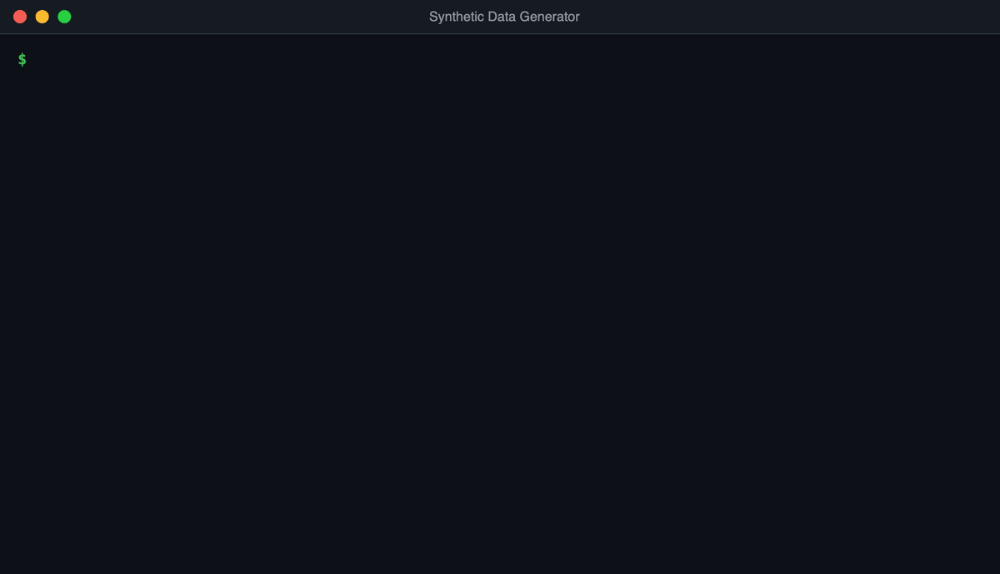
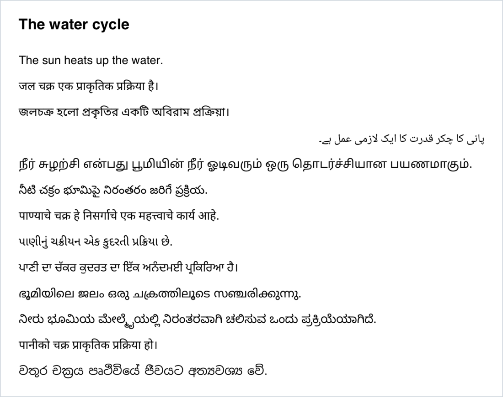

# Synthetic Data Generator

**Generate unlimited synthetic training data on your own machine, for free, with any open-source LLM in Ollama.**

[](https://github.com/Manishmaurya89/Synthetic-data-generator-/actions/workflows/tests.yml)


Stop paying per token. Stop hitting free-tier limits. Pick any model from Ollama, give it a topic, and turn it into
a clean, deduplicated dataset in 13 languages, or into complete structured documents. No API key required.



## Why go local?

|  | Hosted LLM APIs | Synthetic Data Generator |
| --- | --- | --- |
| **Cost** | Pay for every token | Free once the model is downloaded |
| **Limits** | Rate limits and daily caps on free tiers | None. Scale with your hardware |
| **Privacy** | Prompts and data go to the provider | Everything stays on your machine* |
| **Models** | The provider's catalog | Any model in the [Ollama library](https://ollama.com/library) |

<sub>*Except the audio format, which uses Google's online text-to-speech (gTTS).</sub>

## Features

- **Generate** unique sentences on any topic in 13 languages
- **Mix** languages by percentage, such as 60% Hindi and 40% English, with exact sample counts
- **Choose** any installed Ollama model from a menu, or **download** a new one just by typing its name
- **Filter** out numbering, intro lines, duplicates and wrong-language sentences automatically
- **Export** to TXT, JSON, CSV, PDF or MP3 audio
- **Automate** runs with command-line flags, no questions asked
- **Render** PDFs in every script, with proper letter shaping and right-to-left Urdu
- **Create** full structured documents with headings, paragraphs, lists and tables, as JSON and PDF

## Quick start

**1. Install Ollama** from [ollama.com/download](https://ollama.com/download) and start it.

**2. Clone and set up the project:**

```bash
git clone https://github.com/Manishmaurya89/Synthetic-data-generator-.git
cd Synthetic-data-generator-
python3 -m venv .venv
.venv/bin/pip install -r requirements.txt
```

**3. Run it:**

```bash
.venv/bin/python main.py
```

Pick a model, then answer a few questions: languages, number of samples, topic and format. No model yet? Type a
name like `llama3` at the model prompt and the tool downloads it for you.

## Run without questions

Pass the settings as flags to use it in scripts and pipelines:

```bash
.venv/bin/python main.py --langs hin,eng --mix 60,40 --samples 500 --topic "water cycle" --format json --model gemma4
```

| Flag | Meaning | Default |
| --- | --- | --- |
| `--langs` | Language codes, comma-separated | required |
| `--samples` | Number of sentences | required |
| `--topic` | What the sentences are about | required |
| `--format` | `txt`, `json`, `csv`, `pdf` or `audio` | required |
| `--mix` | Percentage per language, in `--langs` order | even split |
| `--model` | Ollama model to use | `llama3` |

Run `python main.py --help` for the full list.

## Use any Ollama model

Every interactive run starts with a menu of the models you already have. Pick one by number, press Enter for the
default, or type any name from the [Ollama library](https://ollama.com/library) to download it on the spot:

```
Local Ollama models:
  1. gemma4-32k:latest  (9.6 GB)
  2. llama3:latest  (4.7 GB)
Type a number, or any model name from ollama.com/library to download it.
Model [llama3:latest]: qwen2.5
'qwen2.5' is not downloaded. Download it now? (y/n): y

Downloading qwen2.5. Large models can take a while...
  qwen2.5 is ready.
```

To change which model Enter picks, set `OLLAMA_MODEL`:

```bash
OLLAMA_MODEL=gemma4 .venv/bin/python main.py
```

### Pick the right model

- **Start with `llama3`** (4.7 GB). It's fast and strong in English.
- **Switch models for South Asian languages.** In our tests, asked for 27 Urdu sentences, llama3 delivered 9 that
  passed the language check, while a Gemma 4 model delivered all 27. If you see a warning that a language came up
  short, try another model.
- **Match the model to your RAM.** Plan on roughly 8 GB for 7–8B models, 16 GB for 13–14B and 32 GB for 30B+.
  Bigger models write richer, more varied sentences; smaller ones finish faster.

## Supported languages

| Code | Language | Code | Language | Code | Language |
| --- | --- | --- | --- | --- | --- |
| `eng` | English | `tel` | Telugu | `mal` | Malayalam |
| `hin` | Hindi | `mar` | Marathi | `kan` | Kannada |
| `ben` | Bengali | `guj` | Gujarati | `nep` | Nepali |
| `urd` | Urdu | `pan` | Punjabi | `sin` | Sinhala |
| `tam` | Tamil | | | | |

## Output formats

Every file lands in `outputs/`.

| Format | File | Contents |
| --- | --- | --- |
| `txt` | `dataset.txt` | One sentence per line |
| `json` | `dataset.json` | `[{"text": "...", "language": "hin"}, ...]` |
| `csv` | `dataset.csv` | `text` and `language` columns |
| `pdf` | `dataset.pdf` | The topic as a title, then every sentence in its script's own font |
| `audio` | `audio/*.mp3` + `audio/metadata.csv` | One clip per sentence in that language's voice, with a CSV linking each clip to its text |

One PDF, all 13 scripts, rendered with proper letter shaping and right-to-left Urdu:



## See real output

Browse [`examples/`](examples) for unedited datasets generated with this tool: 25 sentences in each of the 13
languages, a mixed Hindi and English dataset in JSON and CSV, the full PDF and sample audio clips.

## How it works

```
Topic + languages + model
  → Prompt the local LLM in each language, in that language
  → Clean    strip numbering, bullets and intro lines
  → Check    keep only sentences written in the right script
  → Dedupe   drop repeats, then ask again until there are enough unique sentences
  → Mix      split the samples by your percentages and shuffle
  → Export   TXT, JSON, CSV, PDF or MP3
```

### Built-in quality checks

- **Unique by design.** Every sentence in a dataset is unique. If a model can't produce enough, you get a warning
  and a smaller dataset, never one padded with repeats.
- **Right language, right script.** At least 70% of each sentence's letters must be in the language's own script,
  and stray letters from any third script reject the sentence.
- **Exact counts.** Mixed datasets always add up to the number of samples you asked for.

## Generate structured documents

Need whole documents instead of sentences? The document generator writes a complete article with headings,
paragraphs, bullet lists and tables, then renders it as a PDF. The JSON tells you exactly what the PDF contains,
which makes the pair ready-made test data for document parsers, layout models and RAG pipelines.

```bash
cd "Synthetic Document Generation"
../.venv/bin/python main.py
../.venv/bin/python main.py --topic "Renewable energy in India" --pages 3 --language hin
```

It writes `outputs/output.json` and `outputs/final_output.pdf`. Details are in its
[README](Synthetic%20Document%20Generation/README.md).

## Project structure

```
.
├── main.py            run this: asks for your settings (or reads flags) and runs everything
├── models.py          lists, picks and downloads Ollama models
├── generator.py       prompts the LLM, then cleans and checks every sentence
├── mixer.py           splits samples between languages and shuffles them
├── output.py          writes TXT, JSON, CSV and PDF files
├── media.py           writes MP3 clips and their metadata
├── scripts.py         detects which script a piece of text is written in
├── config.py          languages, fonts, default model and paths
├── fonts/             Noto fonts for every supported script
├── tests/             test suite (runs without Ollama)
├── examples/          real generated datasets
└── Synthetic Document Generation/
                       generates structured documents as JSON and PDF
```

## Roadmap

- Offline text-to-speech, so audio datasets never need the internet
- Support for other local servers such as LM Studio and llama.cpp
- More South Asian languages, such as Odia, Assamese and Kashmiri

## Contributing

Pull requests are welcome, and adding a language is a great first contribution. See
[CONTRIBUTING.md](CONTRIBUTING.md) for setup, tests and a step-by-step guide.

```bash
.venv/bin/pip install -r requirements-dev.txt
.venv/bin/pytest
```

## License

Released under the MIT License (see `LICENSE`). The fonts in `fonts/` are [Noto](https://github.com/notofonts) fonts
under the SIL Open Font License 1.1 (see `fonts/OFL.txt`).
